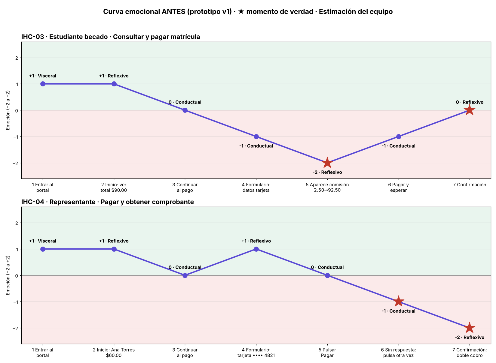

# Diagnóstico UX · Pago académico en línea

## Caso
| | IHC-03 | IHC-04 |
|---|---|---|
| Persona usuaria | Estudiante con presupuesto limitado | Representante que paga a nombre de Ana Torres |
| Tarea crítica | Pagar el valor académico en el portal | Pagar $60.00 con su tarjeta en el portal |
| Restricción obligatoria | Ver el costo total antes de aceptar | No mostrar datos bancarios completos |
| Fallo adicional | Comisión de $2.50 no anunciada (total pasa de $90.00 a $92.50) | Sin estado de proceso: se puede pagar dos veces |

## Touchpoints y curva emocional

### IHC-03
| N.º | Touchpoint | Qué hace el usuario | Emoción (−2 a +2) | Por qué | Nivel | ¿Momento de verdad? |
|---|---|---|---|---|---|---|
| 1 | Entrar al portal | Abre el portal | +1 | Interfaz ordenada e institucional | Visceral | No |
| 2 | Inicio: ver total $90.00 | Revisa cuánto debe | +1 | El monto encaja en su presupuesto | Reflexivo | No |
| 3 | Continuar al pago | Pulsa Continuar | 0 | Paso neutro | Conductual | No |
| 4 | Formulario: datos de tarjeta | Escribe los datos de su tarjeta | −1 | Teme equivocarse al escribir | Conductual | No |
| 5 | Aparece comisión $2.50 (total $92.50) | Ve un cargo que no esperaba | −2 | Cargo no anunciado; siente engaño | Reflexivo | **Sí** |
| 6 | Pagar y esperar | Pulsa Pagar y espera | −1 | Incertidumbre mientras procesa | Conductual | No |
| 7 | Confirmación | Lee el comprobante | 0 | Alivio, pero pagó más de lo previsto | Reflexivo | **Sí** |

### IHC-04
| N.º | Touchpoint | Qué hace el usuario | Emoción (−2 a +2) | Por qué | Nivel | ¿Momento de verdad? |
|---|---|---|---|---|---|---|
| 1 | Entrar al portal | Busca la opción de pago | +1 | Encuentra la opción con facilidad | Visceral | No |
| 2 | Inicio: Ana Torres, $60.00 | Verifica a quién paga y cuánto | +1 | Confirma a quién paga y cuánto | Reflexivo | No |
| 3 | Continuar al pago | Pulsa Continuar | 0 | Paso neutro | Conductual | No |
| 4 | Formulario: tarjeta •••• 4821 | Revisa el método de pago | +1 | Sus datos bancarios no se muestran completos | Reflexivo | No |
| 5 | Pulsar Pagar | Pulsa Pagar | 0 | Espera respuesta inmediata | Conductual | No |
| 6 | Sin respuesta: pulsa otra vez | Vuelve a pulsar Pagar | −1 | No hay estado visible | Conductual | **Sí** |
| 7 | Confirmación con doble cobro | Ve dos cobros | −2 | Pagó dos veces; pierde la confianza | Reflexivo | **Sí** |

## Momentos de verdad
1. **IHC-03 · Aparece la comisión de $2.50 (touchpoint 5):** la confianza se pierde porque el total cambia de $90.00 a $92.50 después de que el estudiante ya decidió pagar. Mostrar el costo total desde el inicio la habría protegido.
2. **IHC-04 · Sin respuesta al pulsar Pagar (touchpoint 6):** sin un estado visible el representante duda y repite el pago. Aquí se gana o se pierde la confianza, y de aquí nace el doble cobro.

(Los touchpoints 7 de ambos casos también son momentos de verdad, porque cierran la experiencia y definen el recuerdo.)

## Hallazgos

| N.º | Problema | Heurística | Severidad | Issue |
|---|---|---|---|---|
| IHC-03 · H1 | La comisión inesperada aparece recién al final y el total pasa de $90.00 a $92.50, después de que el estudiante ya decidió pagar | H1 (visibilidad del estado), H5 (prevención de errores) | 4 (catastrófico): rompe la restricción de ver el costo total antes de aceptar | pendiente |
| IHC-03 · H2 | El mensaje de error de pago es genérico: no dice qué pasó ni qué corregir | H9 (recuperación de errores) | 3 (mayor): un estudiante con presupuesto limitado no sabe si le cobraron | pendiente |
| IHC-03 · H3 | El comprobante no deja verificar que el monto pagado es el total aceptado | H1 (visibilidad del estado) | 3 (mayor): genera desconfianza en el cobro | pendiente |
| IHC-04 · H1 | El botón Pagar permite dos pagos consecutivos | H5 (prevención de errores) | 4 (catastrófico): doble cobro a nombre de otra persona | pendiente |
| IHC-04 · H2 | No hay indicación de que el pago está en proceso, y el representante vuelve a pulsar | H1 (visibilidad del estado) | 3 (mayor): empuja al doble pago | pendiente |
| IHC-04 · H3 | El método de pago no se reconoce sin ver datos bancarios completos | H5 (prevención de errores) | 3 (mayor): choca con la restricción de ocultar datos bancarios | pendiente |

## Curva emocional inicial

## Medición real vs. estimación

**Observado:** nada todavía. En esta fase no hay prueba con usuarios.

**Estimación del equipo:**
- Las emociones (−2 a +2) y la curva emocional inicial son estimaciones basadas en la persona de cada tarjeta.
- Las severidades (0–4, escala de Nielsen) son juicio del equipo.
- Los tiempos y los errores no se estiman: se medirán en la sesión de la Fase 4 (`pruebas/sesion.md`).

**Se verificará en la Fase 4:** si el participante nota el costo total antes de aceptar (IHC-03) y si intenta pagar dos veces (IHC-04). Hasta entonces, los hallazgos son hipótesis.
